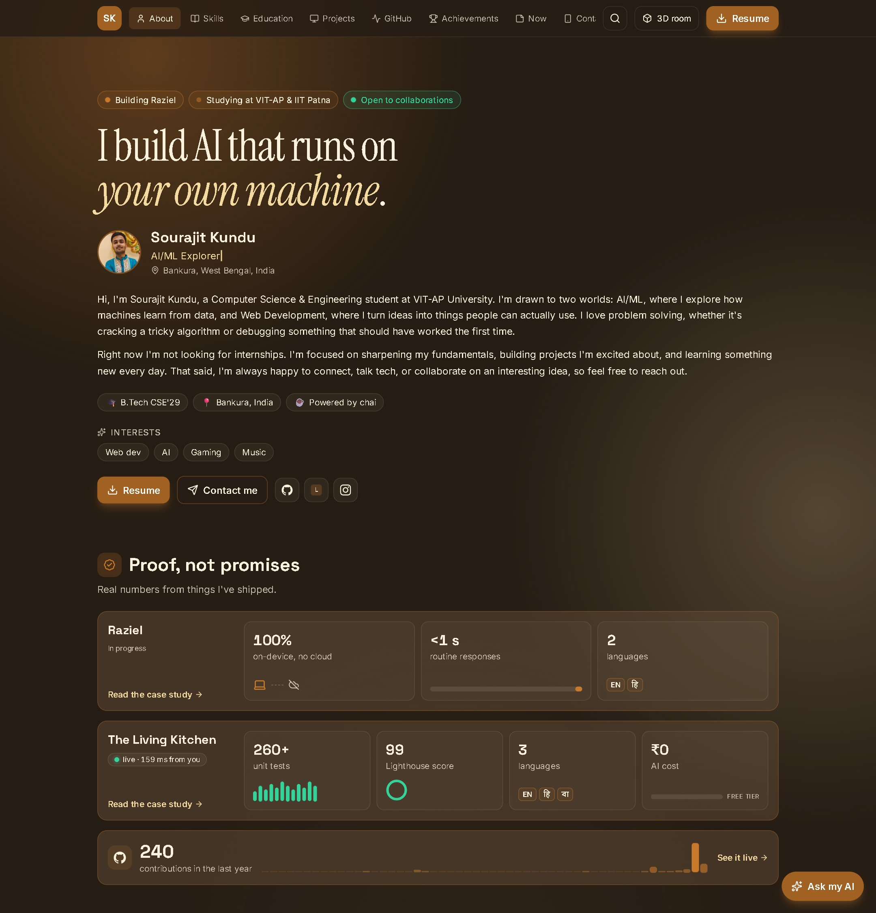
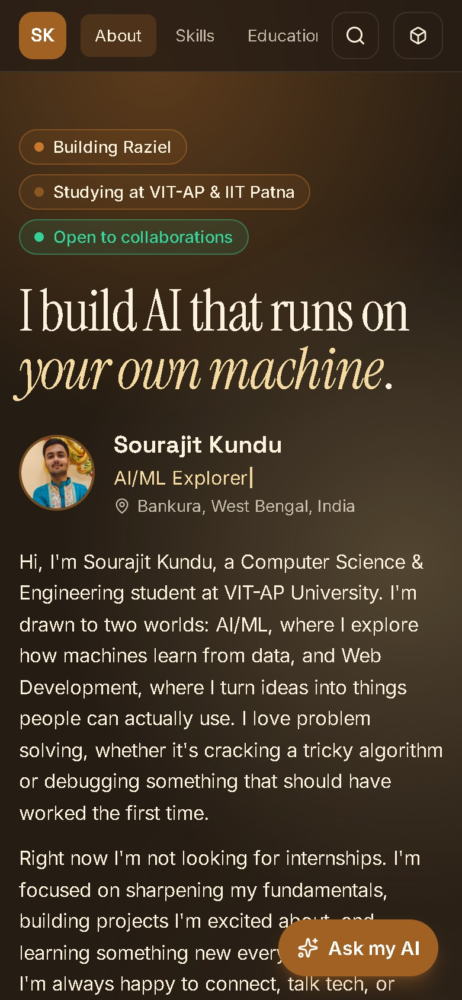

<!--
  Every card on this page is an animated SVG drawn by my portfolio's own server
  (sourajit-kundu.vercel.app/readme/*.svg) from the same content as the site.
  The live ones (proof, GitHub, terminal) refresh with real data every 30 minutes.
-->

  
  
  

 

  
  

### 🖥️ My portfolio

  
  &nbsp;
  

  <a href="https://sourajit-kundu.vercel.app/#simple"><b>Open the portfolio (Simple Mode) →</b></a>
  &nbsp;·&nbsp;
  <a href="https://sourajit-kundu.vercel.app">or walk around the 3D room</a>

 

  

<picture>
  <source media="(prefers-color-scheme: dark)" srcset="https://raw.githubusercontent.com/sourajit-ayush/sourajit-ayush/output/github-snake-dark.svg">
  <source media="(prefers-color-scheme: light)" srcset="https://raw.githubusercontent.com/sourajit-ayush/sourajit-ayush/output/github-snake.svg">
  
</picture>

### ✦ Ask my AI (tap a question)

Each link opens my portfolio with the question already asked. The assistant only knows what's on my site, so it won't make things up.

- [What is Raziel, and how does it run fully offline? ↗](https://sourajit-kundu.vercel.app/?ask=What%20is%20Raziel%2C%20and%20how%20does%20it%20run%20fully%20offline%3F)
- [How does The Living Kitchen cook with AI for free? ↗](https://sourajit-kundu.vercel.app/?ask=How%20does%20The%20Living%20Kitchen%20cook%20with%20AI%20for%20free%3F)
- [What is Sourajit learning right now? ↗](https://sourajit-kundu.vercel.app/?ask=What%20is%20Sourajit%20learning%20right%20now%3F)
- [Is he open to collaborations? ↗](https://sourajit-kundu.vercel.app/?ask=Is%20Sourajit%20open%20to%20collaborations%3F)

 

  

  

<b>Plain-text version</b>

 

**Sourajit Kundu**, B.Tech Computer Science & Engineering student at VIT-AP University and BS Computer Science & Data Analytics student at IIT Patna. I build AI that runs on your own machine, and web apps that feel alive.

**Projects**
- [Raziel](https://sourajit-kundu.vercel.app/projects/raziel): a fully local, bilingual (English/Hindi) AI voice assistant for Windows with real system control. 100% on-device, sub-second replies.
- [The Living Kitchen](https://sourajit-kundu.vercel.app/projects/living-kitchen): a 3D AI recipe generator in English, Hindi and Bengali. 260+ unit tests, Lighthouse 99, ₹0 AI cost. [Live demo](https://living-kitchen-eta.vercel.app)

**Also**: Design Team Co-Lead at Team Next Nexus, VIT-AP · Smart India Hackathon 2026, Round 2 (project *Nidan*)

**Elsewhere**: [Portfolio](https://sourajit-kundu.vercel.app) · [LinkedIn](https://www.linkedin.com/in/sourajit-kundu-3b2403400/) · [Resume](https://sourajit-kundu.vercel.app/resume/resume.pdf)

Open to collaborations.

Every card on this page is an SVG drawn by my portfolio's server from the same content as the site. The live ones refresh every 30 minutes.

